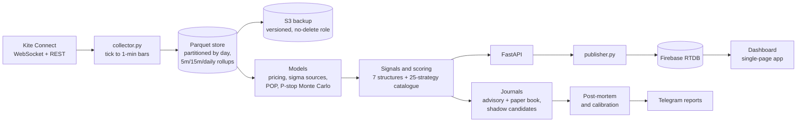
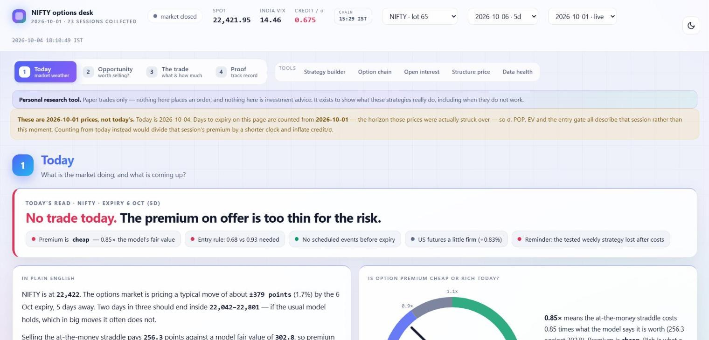
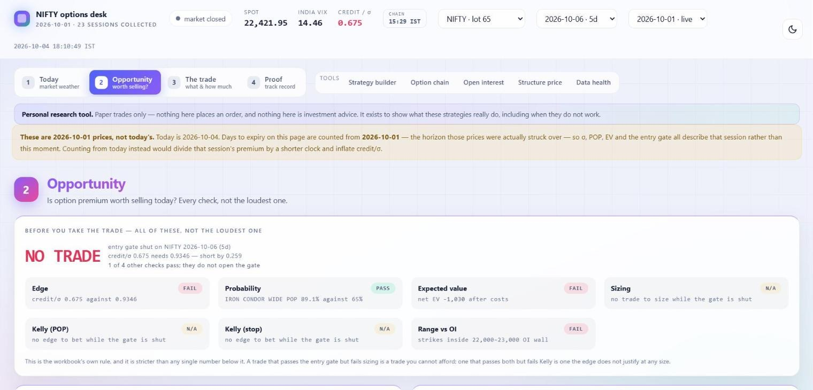
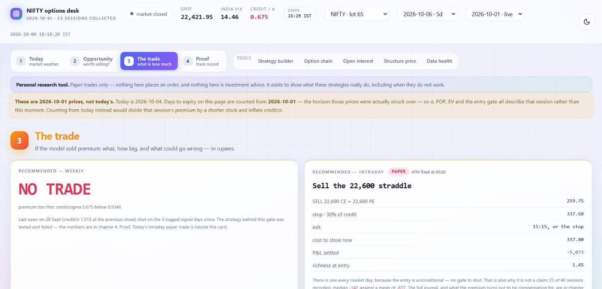
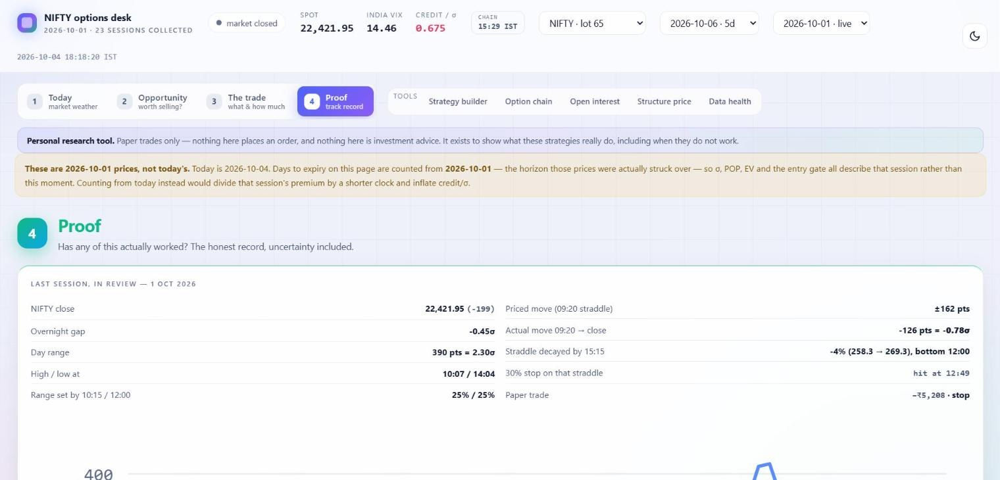
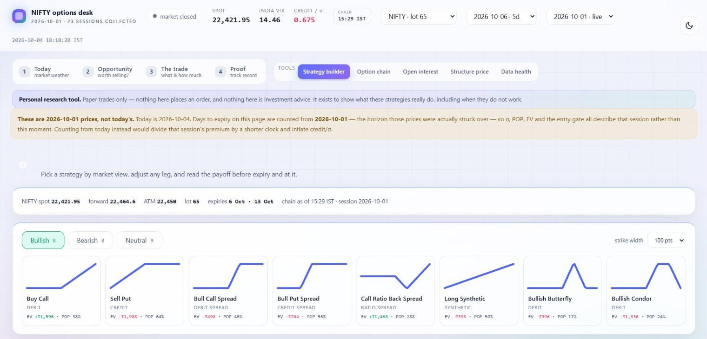
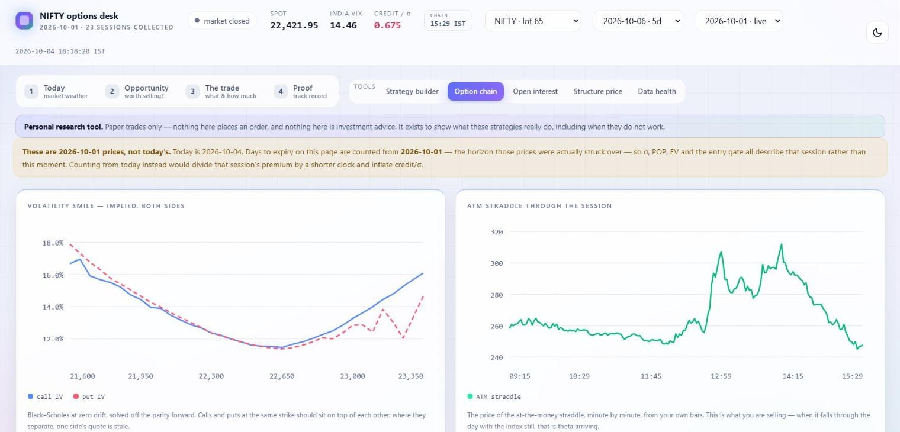
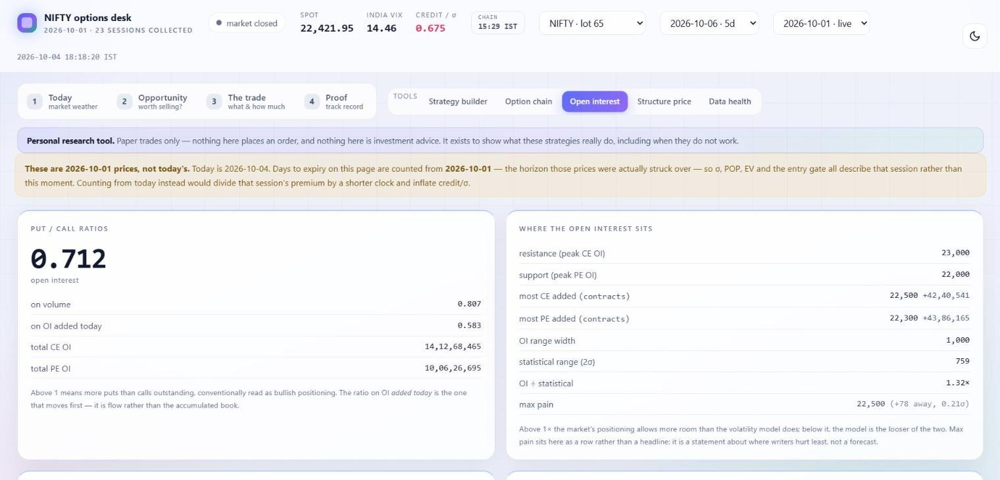
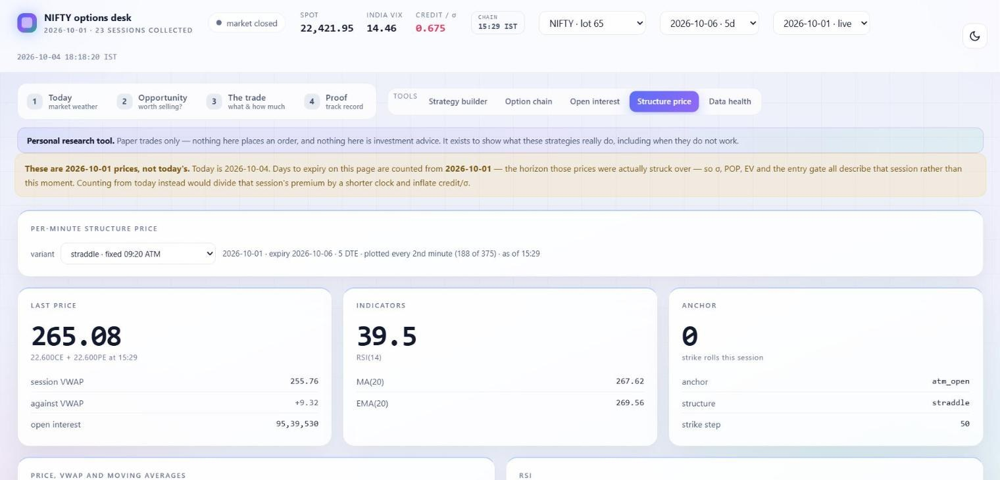
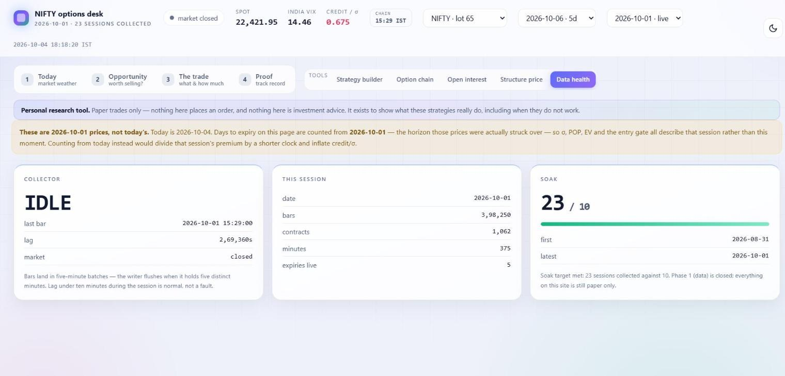

# options-engine


**An end-to-end research system for NSE index options (NIFTY, BANKNIFTY, SENSEX).**
It collects live market data around the clock on AWS, prices and scores option
strategies with probability models, tests those models out of sample, paper-trades
them with real bid/ask fills and charges, and publishes everything to a live dashboard
and a Telegram bot.

Built solo, from an Excel/VBA prototype to a Python service with 540+ automated tests.

> **Research and paper trading only.** Nothing in this repository places a real order,
> and nothing here is investment advice or a recommendation to buy or sell any security.
> The author is not a SEBI-registered Research Analyst or Investment Adviser.

---

## Architecture



Everything runs unattended on one AWS t4g.small (Mumbai) under systemd timers, with a
market-calendar guard, automated TOTP login, end-of-day reconciliation against the
broker's own candles, and a synthetic-tick replay mode for testing offline.

## Screenshots

The live dashboard, light theme, showing the 1 Oct 2026 session (captured on a weekend, so prices are the last close).



| | |
|---|---|
|  |  |
| **Opportunity:** every entry check side by side, not just the loudest one | **The trade:** the weekly entry gate and the daily paper straddle (paper only) |
|  |  |
| **Proof:** the honest track record, starting with the last session in review | **Strategy builder:** 25 strategies grouped by market view, priced on the live chain |
|  |  |
| **Option chain:** implied-volatility smile and the ATM straddle minute by minute | **Open interest:** put/call ratios, OI walls, contracts added and max pain |
|  |  |
| **Structure price:** a fixed-strike straddle with VWAP, MA/EMA and RSI | **Data health:** collector status, bars collected and the soak test |

## What it does

| Area | Highlights | Where |
|---|---|---|
| **Data pipeline** | Live ticks for ~1,700 option contracts across 8 expiries aggregated to 1-minute bars (~190k bars by midday); daily instrument master; Parquet partitions with rollups; EOD reconciliation; morning recovery after outages | [`pipeline/`](pipeline/) |
| **Pricing and volatility** | Bachelier and Black-Scholes pricing off the put-call-parity forward; three sigma sources (India VIX, the expiry's own ATM IV, realised); weekend-aware time decay; implied-vol term structure | [`quant/`](quant/) |
| **Probability and risk** | Probability of profit (normal, lognormal and a historically calibrated version); Monte Carlo probability of a stop being hit, including overnight gaps; expected value after fees and measured slippage; margin, risk-rule and Kelly sizing | [`quant/`](quant/), [`strategy/`](strategy/) |
| **Market microstructure** | Per-strike open-interest buildup (long/short buildup and unwinding), with the forward move removed so price changes are not just the index moving; PCR, max pain, OI walls | [`quant/`](quant/) |
| **Signals and journals** | Daily signal across 7 short-premium structures with an entry gate; intraday paper straddle filled at real bid/ask; an advisory ledger and a separate book ledger; shadow candidate rules tracked forward under a written promotion rule | [`signals/`](signals/), [`tracking/`](tracking/) |
| **Research** | Ten-year replay; walk-forward calibration; P&L attribution into decay, movement, vol, spread and charges | [`research/`](research/), [`tracking/`](tracking/) |
| **Delivery** | FastAPI service; Firebase publisher that only writes changed nodes; single-page dashboard with strategy builder, option chain, OI analytics and a track record; Telegram bot and daily post-mortem | [`service/`](service/), [`firebase/`](firebase/), [`pipeline/`](pipeline/), [`tracking/`](tracking/) |

## What I found

The project is built to test whether an edge is real, not to assume one.

- **The volatility premium exists.** Across ten years of expiries, short-premium zones
  finished inside more often than the model said, by about 6 percentage points. NIFTY
  consistently moved less than India VIX implied, and intraday it moved a median of
  about 0.57x what the 09:20 straddle priced.
- **But it did not survive costs as a weekly strategy.** Measured at the price a seller is
  actually paid, no holding period from 7 to 60 days reached t = 2. An apparent edge at
  0 DTE turned out to be a unit error: a 30-day VIX applied to a one-day horizon.
- **Model probabilities were over-confident live.** Recommended weekly trades predicted
  ~80% POP and realised ~57% (small sample). A historically fitted POP was no better
  than the model's out of sample (Brier 0.21606 vs 0.21608 over 8 years).
- **The daily paper straddle is negative after costs so far,** with fat left tails: many
  days pay a little and a few large days take much more back. With fewer than 40
  sessions recorded, it is too early to call either way.

Negative results are kept on the dashboard on purpose, with confidence intervals and
sample sizes, so nothing is presented as stronger than it is.

## Tech stack

Python (pandas, NumPy, SciPy, PyArrow), FastAPI, Kite Connect API, Parquet, AWS (EC2,
S3, IAM), systemd, Firebase Realtime Database and Hosting, vanilla JavaScript/SVG
charts, Telegram Bot API, pytest, GitHub Actions.

## Project layout

```
pipeline/   live data: broker login, collector, bars, Parquet store, calendar, alerts
quant/      pricing, volatility, probability and option-chain models
strategy/   structures, strategy catalogue, positions, feature store
signals/    daily and live signal generation
tracking/   journals, paper books, shadow candidates, post-mortems
service/    FastAPI endpoints, Firebase publisher, outside-market feed
research/   studies, backtests, calibrations and the ten-year replay
tools/      fixture builder and page render checks
futures/    stock-futures paper system: seven agents, SQLite event store, paper broker, replay
tests/      540+ pytest tests
deploy/     systemd units and install scripts
firebase/   the dashboard (single-page app) and database rules
```

Modules import each other by name (`import pricing`), because the production
server runs everything from one flat folder. `pytest.ini` puts each folder on the
import path for tests and CI; `env.sh` / `env.ps1` do the same for running a script
by hand. `project_paths.py` finds the `data/` folder in either layout.

## Running it

```bash
pip install -r requirements.txt
pytest -q            # 540+ tests, no market data or credentials needed
source env.sh        # (Windows: . .\env.ps1) then e.g. python research/replay.py
```

To run against live data you need a Kite Connect subscription and a `.env` in the
project root (never committed):

```
KITE_API_KEY=
KITE_API_SECRET=
KITE_USER_ID=
KITE_PASSWORD=
KITE_TOTP_SEED=
TELEGRAM_TOKEN=
TELEGRAM_CHAT_ID=
BACKUP_BUCKET=s3://your-bucket
```

Server setup is in [`infra/SETUP.md`](infra/SETUP.md) and the systemd units and install
scripts are in [`deploy/`](deploy/). Market data from Kite Connect and NSE is not included.

## Stock futures paper system

A Stock Futures workspace for NSE single-stock futures (FUTSTK) with two
independently configured modes, **Intraday** and **Swing**, each able to go
long or short. **Paper trading and replay only:** no broker orders, no cash
equity, index futures, options orders or rollovers. Code is in
[`futures/`](futures/), tests in
[`tests/test_stock_futures.py`](tests/test_stock_futures.py), and the page is
[`firebase/public/futures.js`](firebase/public/futures.js).

```
ScanRequested → 1 Market regime → 2 Sector ranking → 3 Stock screening → 4 Nifty Desk verification
  → 5 Futures contract + paper entry (exactly 1 lot) → 6 Position monitor (+ optional override) → 7 Paper exit + journal
```

The agents are deterministic code. They run concurrently as backend workers
(one thread each) and talk only through typed, durable events in one SQLite
file (`data/futures/futures.db`). Every event carries a unique id, the schema
version, scan id, trade id, mode, config version, direction, producer,
instrument id and event time. Each step commits its state change, its output
events and the mark that its input was handled in **one** transaction, so a
retry or a duplicate cannot apply it twice. Restarting picks up open
positions, pending orders, approvals, reservations and unresolved exits. Shutting
the dashboard does not stop the worker.

Direction is explicit everywhere. **LONG opens with BUY and closes with SELL.
SHORT opens with SELL and closes with BUY to cover.** The position monitor
prices a long off the bid and a short off the ask (the side that can actually
close it). Stocks are chosen and verified on the underlying share's data. The
futures contract's own quotes and metadata are used to open, mark and close.

### Running it locally

```bash
pip install -r requirements.txt
pytest -q tests/test_stock_futures.py tests/test_futures_regime.py tests/test_futures_screen.py   # 86 tests, synthetic fixtures

# Fixture demos (synthetic data, injected clock, labelled FIXTURE)
python futures/sf_cli.py demo --scenario bullish        --mode intraday   # LONG: BUY then SELL
python futures/sf_cli.py demo --scenario bearish        --mode intraday   # SHORT: SELL then BUY to cover
python futures/sf_cli.py demo --scenario swing-bullish  --mode swing      # holds over the weekend and the 24 Nov holiday
python futures/sf_cli.py demo --scenario swing-bearish  --mode swing      # short gaps up through its stop
python futures/sf_cli.py demo --scenario sideways       --mode both       # no entries
python futures/sf_cli.py demo --scenario bullish --mode intraday --until 10:52 --out firebase/public/futures-demo.json

# Replay one collected session from the repo's own data (point-in-time reads, labelled REPLAY)
python futures/sf_cli.py replay --source repo --date 2026-11-12 --mode intraday
python futures/sf_cli.py replay --source repo --date 2026-11-12 --mode swing

# Live paper worker (real clock, repo data). Entries stay disabled until configured; see below.
python futures/sf_cli.py worker --source repo --mode both
python futures/sf_cli.py status
python futures/sf_cli.py pause --scope global --on        # or --scope intraday|swing, --off
```

The page shows `/futures-demo.json` under a FIXTURE banner until the worker has
published real data. To view it locally, run
`python -m http.server 8765 --directory firebase/public` and open
`http://localhost:8765/#sfut`.

### Configuration

[`futures/config/default.json`](futures/config/default.json) is versioned.
Each config is stored in the database under a content hash. Every scan and
trade records the version it used, and an open position keeps its version and
exit plan until it closes. Edits only affect future trades, unless an
authorised override changes one trade's active plan. The shipped rules are
**labelled demo examples** (`"label": "DEMO EXAMPLE RULES…"`,
`"rules_validated": false`).

```jsonc
"profiles": {
  "intraday": {
    "benchmark": "NIFTY 50", "scan_cadence_s": 300, "candidate_ttl_s": 240, "max_data_age_s": 180,
    "entry_window": ["09:45", "14:30"], "exit_deadline": "15:15",
    "regime": { "method": "opening_range_fib_vwap", "opening_range": {"start": "09:15", "minutes": 15},
                "fib": {"low": 0.380, "mid": 0.500, "high": 0.618}, "confirm_interval_min": 1,
                "vwap_source": {"symbol": "NIFTY FUT", "label": "NIFTY near-month futures (VWAP proxy)", "kind": "proxy"} },
    "direction_map": {"BULLISH": ["LONG"], "BEARISH": ["SHORT"], "SIDEWAYS": [], "UNAVAILABLE": []},
    "sector": {"require_absolute": true, "require_relative": true, "min_coverage": 0.6, "top_n": 3},
    "stock":  {"method": "opening_range_breakout_vwap", "opening_range": {"start": "09:15", "minutes": 15},
               "lookback": {"basis": "current_session", "minutes": 30}, "top_n": 5, "min_turnover_rs": 50000000},
    "verification": {"long":  {"all": [["turnover_rs", ">=", 5e7], ["money_flow_net_rs", ">", 0], ["oi_read", "==", "long buildup"]]},
                     "short": {"all": [["turnover_rs", ">=", 5e7], ["money_flow_net_rs", "<", 0], ["oi_read", "==", "short buildup"]]}},
    "contract": {"expiry_preference": "nearest_eligible", "max_spread_ticks": 20, "min_top_qty_lots": 1},
    "approval": {"entry_required": false, "entry_window_s": 120},
    "override": {"enabled": true, "response_window_s": 300, "allowed": ["stop", "target"]},
    "exit_plan": {"stop": {"basis": "opening_range_edge"}, "target": {"basis": "r_multiple", "value": 2}, "hard_max_stop_pct": 2.5,
                  "missing_quote_policy": "retry_until_quote", "cutoff_grace_s": 600}
  },
  "swing": { "regime": {"method": "return_structure", "lookback_sessions": 5, "threshold": 0.005}, "entry_window": ["14:30", "15:10"],
             "contract": {"pre_expiry_buffer_sessions": 1},
             "exit_plan": {"stop": {"basis": "pct", "value": 3.0}, "target": {"basis": "pct", "value": 6.0},
                           "max_holding_sessions": 5, "holding_count": "sessions_after_entry", "session_exit_time": "15:15"} }
},
"shared": { "mode_priority": ["intraday", "swing"], "one_position_per_underlying": true, "max_open_positions": 6,   // 3 per mode
            "max_gross_notional_rs": 6000000, "margin_pct_estimate": 0.20, "margin_budget_rs": 1200000, "daily_loss_limit_rs": 50000,
            "fill_policy": {"slippage_ticks": 1, "max_quote_age_s": 90, "partial_fills": false, "granularity": "lot",
                            "bar_model": "next_bar_open/1", "bar_ambiguity": "stop_first"},
            "exit_precedence": ["hard_risk", "stop", "pre_expiry_deadline", "intraday_deadline", "max_holding", "invalidation", "target"],
            "costs": {"brokerage_per_order_rs": 20, "stt_sell_pct": 0.02, "exchange_txn_pct": 0.00173, "stamp_buy_pct": 0.002, "gst_pct": 18} }
```

Market regime rules (your specification, [`futures/sf_regime.py`](futures/sf_regime.py)):
- **Intraday.** The opening range is the completed NIFTY 50 bars in [09:15, 09:30); nothing at or after 09:30 counts.
  Fib_038 / Fib_050 / Fib_0618 are measured up from the range low and frozen for the session. BULLISH means the NIFTY 50
  close is above Fib_0618 *and* the VWAP source closes above its own session VWAP. BEARISH is the mirror image below Fib_038.
  A close inside or exactly on the zone, a close exactly at VWAP, or disagreement between the two checks is NEUTRAL (shown as
  SIDEWAYS: no entries). The status is NOT_READY while the range is forming. Missing, stale or misaligned data gives
  UNAVAILABLE. Only completed-bar closes count, so a wick through a level does not.
- **VWAP source.** The NIFTY 50 index has no traded volume, so VWAP comes from a NIFTY near-month futures contract (a
  proxy, labelled on the page). Its own close is compared with its own VWAP; prices are never mixed across instruments.
  **The collector does not record NIFTY futures today**, so this feed is missing and Intraday stays UNAVAILABLE until it is added.
- **Swing.** ret = Close[t] / Close[t-5] - 1 over exchange sessions (needs six completed closes). BULLISH: ret > +0.5% and a
  higher high (High[t] > High[t-1]). BEARISH: ret < -0.5% and a lower low. An outside day is settled by the return.
  Comparisons are strict, so exactly ±0.5% and equal highs or lows do not count. A gap or stale data gives UNAVAILABLE.

Stock, verification and exit rules (your specification):
- **Intraday screening** ([`futures/sf_screen.py`](futures/sf_screen.py)). This runs only inside sectors that qualify. Each stock
  gets its own [09:15, 09:30) high and low, frozen for the session. The breakout bar is the latest completed bar starting at
  or after 09:30. **LONG** needs close > the stock's session VWAP, close > its opening high, return > NIFTY 50's return over
  the same aligned window, and the minimum turnover. **SHORT** is the mirror image (below VWAP, below the opening low,
  return < NIFTY). Comparisons are strict, so a close exactly at VWAP or on the range edge fails and a wick does not count.
  Incomplete, zero-width, stale or misaligned inputs give UNAVAILABLE. Longs rank by excess return descending, shorts
  ascending, then by higher turnover, then symbol. The page explains why the first candidate leads. Stock VWAP uses the
  collector's 1-minute traded value (tick price × volume) ÷ volume. Swing keeps its own screener.
- **Verification (both modes).** Long: estimated money flow > 0 **and** the futures OI reading is *long buildup* (price up,
  OI up). Short: money flow < 0 **and** *short buildup*. The reading is the same one the Pulse page shows. Minimum turnover
  still applies.
- **Intraday exit.** The stop sits at the stock's opening-range edge and the target is 2× that risk. Because the stop is
  defined on the stock but the trade is in futures, the distance is measured as a percentage on the stock (signal close →
  opening low/high) and applied to the futures fill. Both levels are recorded. If the distance is beyond
  `hard_max_stop_pct` (2.5%), the entry is skipped. Everything is closed by 15:15 at the latest.
- **Swing exit.** Stop 3%, target 6%, maximum 5 trading sessions, plus the pre-expiry deadline.

Rules that are fixed in code, whatever the config says:
- An entry is always one lot of the resolved contract. If one lot breaks a
  limit (open positions, notional, estimated margin, daily loss, entry
  window), the entry is skipped and the next candidate is tried. The size is
  never cut.
- Only one active entry or position per underlying across both modes and
  directions. This is enforced by a database key, so a signal in the other
  direction can neither open a second position nor reverse an open one. When
  the two modes compete in the same scan time, the mode listed first in
  `mode_priority` reaches the entry agent first.
- Fills: BUY at the ask plus slippage, rounded up to the tick. SELL at the bid
  minus slippage, rounded down. No fill from a stale, missing, one-sided or
  crossed quote. A close can never fill more than the open quantity. Bar-only
  replay uses a separately named model (`next_bar_open/1`). If one bar spans
  both the stop and the target, the stop is assumed to come first.
- Swing: a contract qualifies only if the sessions left before its pre-expiry
  deadline cover the planned hold. That deadline is `pre_expiry_buffer_sessions`
  sessions before the expiry session (the session before, if expiry falls on a
  holiday), at `session_exit_time`. Sessions held are counted as exchange
  sessions after the entry session. Gaps exit at the first eligible quote, and
  the trigger price and fill price are recorded separately. No settlement is
  invented and nothing is rolled.
- Intraday: at the exit deadline, any unfilled entry quantity is cancelled and
  the filled position is closed. If no usable quote arrives within
  `cutoff_grace_s`, the trade is marked `intraday_cutoff_exception` and kept
  out of settled P&L. It is not relabelled as Swing and no fill is invented.

### Data adapters and the connections current-session paper trading needs

[`futures/sf_data.py`](futures/sf_data.py) defines `FixtureData` (synthetic
scenarios) and `RepoData`, which reads the site's own stores. Every record has
a source timestamp and an `available_at` time. `PointInTime` raises an error
if any record is returned before it was available, so replay cannot look
ahead.

| Feed (`live.required_feeds`) | Where it comes from now | What is missing for current-session paper entries |
|---|---|---|
| `benchmark_bars` | `data/bars_1m/date=*/underlying=INDEX` (`NIFTY 50`) | Nothing for Intraday. Swing builds daily bars from collected sessions, so it needs ≥ 6 collected sessions. |
| `vwap_source_bars` | Read from `data/bars_1m/…/underlying=NIFTY` rows with `opt_type` FUT, if they exist | **Missing.** The collector skips index futures (`INDEX_FUT_NAMES` in `instruments.py`). Subscribe the NIFTY near-month future (one more token) so Intraday has a real traded-volume VWAP. |
| `stock_bars` | `data/stocks_1m/…/underlying=EQ` (collector, QUOTE mode) | Nothing, once the stock layer runs (STOCKS≠0). |
| `sector_map` | `data/sectors.json` (`pipeline/sectors.py`). `Others` is treated as unresolved and excluded. | Nothing. Sector indices are not collected, so sector returns are aggregated from constituents (labelled on the page). |
| `futstk_master` | `data/instruments/<day>.json` (`kind: stock_fut`) | **`tick_size`**: `pipeline/instruments.py` now writes it on the next master build. Until a master has it, contracts are rejected. **Only the nearest expiry is collected**, so Swing cannot choose next month. To allow that, add further FUTSTK expiries to `choose_stocks`, which costs extra websocket tokens. Listing/trading status is assumed `listed` because Kite's dump has no status field. |
| `futstk_quotes` | `data/stocks_1m/…/underlying=STKFUT` bid/ask/qty (FULL-mode depth, last value of each minute) | Usable for minute-level paper fills. Tick-level quotes would need a quote recorder. |
| `desk_snapshot` | Recomputed from the same `stocks_1m` bars via `quant/market_pulse.py` (turnover, money-flow **estimate**, OI change) | Nothing. The page notes that screening and verification share a source. |

Calendar: `exchange_calendars` XBOM (as in `pipeline/market.py`). **The
installed version stops at 2026-12-31**, after which the code falls back to
weekdays only. Upgrade it, or list holidays in `calendar.extra_holidays`,
before running into 2027.

Current-session entries need **all** of the following. Until then, analysis,
monitoring and exits run, and each scan records the exact blocking reason:
1. Your real rules in the config, with `"rules_validated": true`.
2. `"live": {"entries_enabled": true}`.
3. Every required feed reporting `ok`. Check with `python futures/sf_cli.py status`, or Feed health on the page.
4. Portfolio limits and an exit plan for each mode. `validate_config` checks the structure.

### Dashboard and operator access

The Stock Futures tab shows, for each mode: the regime and its evidence,
ranked sectors and stocks with pass/fail reasons, verification evidence
(estimates and observations labelled), the chosen contract, the no-trade
reason, feed health, pending approvals, orders, fills and positions (direction,
order purpose, lots, units, active exit rules, Intraday deadline, Swing session
count and pre-expiry deadline, overnight flag, unresolved exits), the agent
timeline, and a journal with mode and direction filters and CSV export.

Firebase (`/live/futures`) is **read-only**. Operator controls exist only on
the API (`/api/futures/ops/pause|approval|override|config`). They need the
service's existing `DASH_USER`/`DASH_PASS` Basic auth or `DASH_TOKEN`, and if
neither is configured they refuse (403). The worker writes
`data/futures/state.json` every 15 s. The publisher and `GET
/api/futures/state` read that file and never open the database, because both
units run with `ProtectSystem=strict`. **For API operator writes,** add
`ReadWritePaths=/home/ubuntu/data/futures` to `options-api.service`. Otherwise
use the CLI on the box. Deployment templates (not installed):
[`deploy/options-futures.service`](deploy/options-futures.service),
[`deploy/run_futures.sh`](deploy/run_futures.sh). On the server, copy
`futures/*.py` into the flat folder and `futures/config/` beside them.

### Live operation: alerts, daily summary, checks

- **Telegram alerts** ([`futures/sf_report.py`](futures/sf_report.py)) go through the existing `pipeline/notify.py` bot
  (`TELEGRAM_TOKEN`, `TELEGRAM_CHAT_ID`). You get a message when a paper trade opens or closes (with net P&L), when an exit
  is unresolved, when an override is applied, when the worker starts, and for the daily summary. Each alert is claimed in
  the database before it is sent, so a crash can drop one but never send it twice. A Telegram outage never blocks trading.
- **Daily summary**: once per session after 15:35 IST, the worker stores the day's scans, market labels, trades, P&L by
  mode and direction, unresolved exits and most common no-trade reasons. It appears on the Journal tab and in Telegram.
- **Check script** (read-only): `bash ~/futures_check.sh` on the server shows services, memory, the worker's footprint,
  today's NIFTY-futures bars, master tick sizes, feed health, the latest scan per mode, positions and recent worker errors.
- **Server footprint**: measured on a full synthetic day (220 stocks, both modes), the worker peaks at about 190 MB and a
  scan cycle takes about 9 s. The unit caps it at 230 MB soft and 320 MB hard, and the kernel stops the worker, never the
  collector. The NIFTY near-month future is recorded in `stocks_1m/IDXFUT` (one extra token).

### Operator runbook

| Situation | What to do | What the system does |
|---|---|---|
| Stop new entries | `sf_cli.py pause --scope global --on` (or a mode), or Pause on the API page | Scans still run and show evidence. Monitoring, exits and reconciliation continue. |
| Restart / crash | `systemctl restart options-futures` or rerun `worker` | Handlers are idempotent. Open positions, working orders, approvals, reservations and unresolved exits resume from SQLite. |
| Feed missing or stale | Check Feed health, `status`, the collector logs | The regime becomes UNAVAILABLE, stale verification is UNAVAILABLE, no new entries. Positions are flagged `data: …` and still close on time rules. |
| Unresolved exit | Find rows with class `unresolved` in the journal, or `status` | Intraday `retry_until_quote` keeps the close order working and fills when a quote returns (the trade is then `excluded`, not settled). `manual` cancels it, sets UNRESOLVED and waits for you. Swing past expiry is set UNRESOLVED with no settlement. Reconcile by hand and record the outcome in your notes. |
| Override an exit | API page → Positions → Override exit, before the deadline | Checks side, the hard risk limit, the pre-expiry deadline and the deadline itself, and is audited. Late, invalid or post-claim overrides are refused and the default plan stays. |
| Event keeps failing | `dead_letters` in the state / `failures` table | An event that fails 5 times stops being retried. Fix the cause, then delete its `failures` row to retry it. |

## Roadmap

- A daily market-view model: probability of up, down or sideways, plus an IV rich/cheap label
- Strategies grouped by regime (neutral, directional credit and debit, long vol), with custom strategies defined in YAML
- A ₹20 lakh paper book with regime shadow books, daily and per-expiry reports
- Live execution only after a long paper record, under SEBI's retail-algo rules

## Author

**Nisarg** · Computer Science (Data Science) student, Monash University, Melbourne
